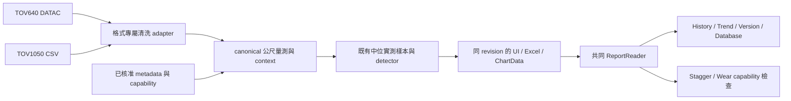

# 雙系統與跨模組測試回饋：已批准設計

- 日期：2026-10-29（Asia/Hong_Kong）
- 狀態：已批准並完成實作及針對性自動驗證；人工驗收待辦。
- Linear：[DAV-25](https://linear.app/david-chu/issue/DAV-25)，關聯 DAV-20／21／24。
- Repo：`C:/Smart Maintanence/TOV1050_Analyzer`，HEAD `2f6f173`，以目前含未提交修改的工作目錄為準。
- 需求：[需求紀錄](../../requests/2026-10-29-dual-system-test-feedback.md)
- 後續：[開發計劃](../../plans/2026-10-29-dual-system-development-plan.md)

## 實作狀態與設計落地

本設計已獲使用者approve並由主代理及三名子代理實作，無需再等待設計批准。[最終驗收紀錄](../../verification/2026-10-29-dual-system-validation.md)為目前實際行為／測試／限制的權威；下文「現況證據」屬實作前調查，其後各節保留批准時的設計意圖。

落地差異：中央 `config/line_catalog.json` 由Python與TypeScript直接共用，另提供catalog API，前端啟動不fetch；DB維持schema，保存canonical parent／session／Section，沒有持久保存source_line/source_track原始別名。ReportContext與新報表仍保留provenance。History／Version遇已知多／跨Section明確要求分開比較。

已完成九線／分支身份、Stagger缺配置快檢、Trend五欄、History／DB、Exception UI／命名／圖表及About。實際TWL enrichment仍缺核准interval，raw冷讀約37–45s；Electron及原生Excel人工驗收未完成。新線工程配置未核准時仍不可計算，不以選單存在宣稱全功能可用。

## 目標與已確認決策

同一個程式支援九個主 Line：TOV640 的 EAL、TML，以及 TOV1050 的 AEL、TCL、KTL、ISL、TWL、TKL、DRL。依使用者 2026-10-29 澄清，LMC 是 EAL 分支，TKS 是 TKL 分支，均不列為獨立 Line。DRL 分支為 UT／PL，使用者另已確認分支 UT 對應現有程式的 Mainline。原始 DATAC／CSV 各用自己的格式轉接器；清洗完成後透過共同報表契約進入下游模組。主 Line、分支 branch、行車方向 direction、metadata profile、舊版 session／section 與工程計算能力分別保存。

使用者已確認其他路線尚無核准的 Stagger 計算配置。因此「能辨識及驗證報表」與「具備工程計算配置」分開處理。缺配置時明確列出路線及所缺項目並停止計算，不借用 EAL／TML 係數。

沿用 2026-10-26 已批准的中位實測樣本邏輯，只移除輸出檔名 `_MedianSample`。此處理規則是既有 AGENTS raw-only detector 規範的明確使用者例外，本次不改回 raw detector，不加入 noise filter。

## 現況證據與問題分類

以下路徑相對 repo。知識圖譜用於發現符號，但部分索引行號落後現有工作目錄，調查已對讀實際檔案。行號是本次調查定位，實作時須重新確認。

| 問題 | 現況／證據 | 設計影響 |
|---|---|---|
| AEL Stagger 顯示 Unsupported stagger line 空白 | `backend/app/api/endpoints/calculation.py` 的 `_infer_stagger_line` 只接受 EAL/TML；metadata／Keq 分派同樣受限 | 修正解析及錯誤分類，不能只擴充 allowlist 後沿用係數 |
| DT 方向風險 | `stagger_selector.py` 的 `_normalize_track` 只認 down/dn，其他值預設 up | 明確方向對照，未知值禁止預設 up |
| Trend AEL→EAL | `frontend/src/store/useTrendStore.ts` 的 `inferLineFromFiles` 非 TML/EAL 預設 EAL | 後端報表 context 為權威，移除靜默 fallback |
| Trend 缺 context 欄 | 現有 Trend table／result 已有五欄；parser 對 station header aliases 不完整 | 追查解析→聚合→API→store→table；不重複新增欄位 |
| History 只可儲存兩線 | `SaveToDBDialog` 的 LINE_OPTIONS 只有 EAL/TML | 擴充 identity 與保存驗證，不能單改選單 |
| 其他模組限制 | Wear cycle types/metadata、useWearStore、Check1YearDialog 受 EAL/TML 限制；Database LineTabPanel 反而只有七條 TOV1050 線 | 全模組能力矩陣與共同 registry |
| 三個 enrichment 欄空白 | `ExceptionTable.tsx` 已有三欄；兩份 TWL xlsx 的 Summary／ChartData 亦已有欄；_Metadata 記錄相關 interval unavailable | 同時處理可見性／缺資料狀態與真正 metadata 依賴 |
| 檔名後綴 | `analysis.py` 的 `_export_job_work` 約 643–644 行加上 `_MedianSample` | 所有匯出入口統一 filename builder；保留 workbook algorithm provenance |
| 概覽沒有 threshold | `ChartComponent.tsx` 有預設 true 的 Thresholds 開關，但 shapes 建立包在 selectedException 條件內 | threshold 顯示與 selection 解耦 |
| marker 未按預期放大 | 選取後 detail 用 FromM−100/ToM+100，顯示 range 又採另一個 length/padding 公式 | 統一成點的實際里程 ±100m，選取、顯示與請求同範圍 |
| wheel zoom 422 | 前端直接傳 Plotly range；`analysis.py` 約 715–716 行 Query ge=0；使用者 from_m=-919.16 會驗證失敗 | 前後端共同區間政策，不把 viewport padding 當資料格式錯誤 |
| 30 秒 timeout | 已有 debounce/cancel/generation guard；單 detail limiter、整 frame 轉換；raw overview detail 會重讀及重算 hash | 先量測冷／熱路徑，縮小工作量及有限快取；尚未證實單一 timeout 根因 |

兩份指定 TWL MedianSample workbook 的 ChartData 具有 `task_run_date,line,track,Section,task_no,station_start,station_end`，首筆 context 為 TWL／UT／Mainline／U1／CEN／TSW；指定 AEL 報表亦有同一組欄，context 為 AEL／UT／Mainline／U3／SHR／AWE。三份報表的缺欄問題都不能直接歸因於 XLSX 沒寫 context，須追蹤候選模型、聚合 join 與執行中的 Electron build。現有 Trend lookup 只以 TL 為鍵且第一筆優先，空 TL 又不建立 metadata，這是五欄遺失及跨 context 污染的具體風險。

## 方案比較

| 方案 | 優點 | 代價／限制 |
|---|---|---|
| A：逐頁補路線常數 | 局部修正快 | parser、方向、DB identity、metadata／Keq 仍會不一致，無法滿足全模組需求 |
| B：共用路線與報表契約，逐模組遷移（建議） | 沿用現有 detector、報表、DB 交易與 UI，集中修正真實錯誤，能逐階段回歸 | 需處理 LMC／TKS legacy identity 與各模組能力依賴 |
| C：全面重寫兩系統及所有報表／資料庫 | 長期模型可重新整理 | 變更與回歸範圍大，不適合本次測試修正 |

採 B。以小範圍 adapter／registry 抽離重複規則，不重寫整個分析平台。

## 路線、方向與能力設計

後端提供單一 registry 及唯讀 API，前端 selectors／validation／filters 消費同一資料，不再各自硬編碼。每個 entry 至少包括：`line_code`、可用來源系統、各主線合法 `branches`、各分支合法 direction、`metadata_profile`、legacy session／section／storage 映射、各模組 capability 與 blocking reason。capability 依 line＋branch＋direction 的已驗證設定及 coverage 推導，不是一個永久 true 的「支援」標記。

| 類別 | 主 Line | 分支／相容處理 |
|---|---|---|
| TOV640 | EAL、TML | EAL 分支為 Mainline／LMC；LMC 的 parent line 永遠為 EAL，兼容現有 EAL group／LMC class／Section。TML 依已驗證設定列分支 |
| TOV1050 | AEL、TCL、KTL、ISL、TWL、TKL、DRL | TKL 分支 Mainline／TKS；DRL 分支 UT／PL，其中 UT 對應 legacy Mainline；其他路線依已驗證配置 |

介面採 Line → Branch → Direction 的相依選擇，Branch 選項由已選 Line 提供；既有 wire 欄 `session` 可透過 adapter 相容，不為改 UI 強行全庫換欄。表格與匯出保留 parent Line 及分支，不能只顯示 EAL 而丟掉 LMC，也不能把 LMC 填進 canonical Line。舊來源若使用 `line=LMC`／`line=TKS` 或來源格式定義的複合碼，須依來源版本的明確 alias 及其他欄位證據轉成 parent line＋branch，保存 source identity／轉換 provenance；衝突不能直接當有效 Line 或偷偷猜測。

上表列本次確認的分支；不因這次更正刪除其他既有合法 Section。TOV640 介面現有 LOW／RAC 亦須保留原來 Section 及 metadata 語義，不能未經盤點便當成新主線或改成 LMC。`branch` 是領域分支，`legacy_session` 是舊API的分支欄，`client_session_id` 則是分析分頁／快照身份，三者不能混為一個session。

### TOV640 LMC hardcoding 核實（只讀）

已按該 repo AGENTS 確認 `C:/Smart Maintanence/TOV640_Analyzer` root，並選匹配的圖譜索引檢查；未修改其程式或查寫正式 DB。

| 位置（相對 TOV640 repo） | 實際行為 | 新版相容策略 |
|---|---|---|
| `frontend/src/views/ExceptionGeneratorView.tsx:524`、`SaveToDBDialog.tsx:52` | 主 Line 為 EAL/TML，LMC 在 EAL 的 Section 選項 | 保持 parent EAL，分支 LMC |
| `backend/app/core/metadata.py:166`、`:371` | EAL 下 Class=LMC；EAL＋LMC 讀 LMC UP/DN sheet | Class／sheet lookup 作 metadata adapter，不改主 Line |
| `backend/app/core/calculation/wear_historical_adapters.py:245` | LMC sheet 明確映 EAL group＋LMC class | 使用來源專屬 adapter，保留原 sheet／source identity |
| `backend/app/core/database.py:785`、`:792` | migration 將 legacy LMC group/class 映 EAL group＋LMC class | 有舊別名相容規則，不代表正式DB已查到此類列；不可全庫無條件改寫 |
| `backend/app/core/calculation/wear_annual_repository.py:69`、`:131` | annual observation 的 `line` 實際等於來源 sheet 名，會保存 LMC | 此 `line` 是來源報表身份，不能當canonical主線；保留source欄，進共同模型時才由該來源adapter解析 |
| `backend/app/core/data_ingestion.py:18`、API filename builder | loader保留來源LINE值；filename builder可原樣接收line，custom檔名甚至省略分支 | 接受字串不等於核准Line；只有檔名、缺分支時不自動猜LMC |

因此確有 `line=LMC` 的局部 hardcoding／舊別名契約，但主流程仍以 EAL＋分支為準。實作 P0/P1/P5 必須檢查來源 artifact 的欄位語義，禁止跨 domain 全域替換名為 `line` 的欄位。

### 分支、方向與工程能力

DRL 的 `branch=UT` 與來源 `Track=UT` 屬不同維度；例如 DRL／branch UT／track UT 對應 legacy line DRL／session Mainline／track UT。改 track 不改分支，改分支不替使用者選方向。舊報表 DRL／session Mainline 可映回 branch UT；其他路線的 Mainline 不受此 DRL 專屬 alias 影響。未經驗證的 branch＋direction 組合不得因字面上可組合就宣稱可用。

來源 track 保存在 provenance。內部方向為明確 enum，UP／UT／up 對同一方向，DN／DOWN／DT／down 對另一方向；不同下游以 adapter 轉成它所需的鍵。未知／混合方向必須診斷，不能預設 up。

registry 支援某路線不代表該路線所有工程功能已可用：Stagger 需核准係數及 support metadata，配置鍵含 branch／direction，EAL Mainline 有配置不能推論 LMC 可套用；Wear scope 需核准 TL interval；DRL 各 branch／direction 仍需 coverage 驗證。一般報表分析、儲存、查詢不得因此只剩 EAL/TML。

## 統一報表契約與資料流

先保留現有外部表頁及欄名，集中建立 ReportReader／ReportContext adapter。未帶新 metadata 的舊報表仍可讀取；新的契約版本與 provenance 放 `_Metadata`，不靠檔名後綴辨認演算法。

- Context：date、parent line、branch、track/direction、legacy session、section、task_no、station_start/end、source system、algorithm version、digest/revision。Branch 與 Section/Track Type/Class 不互相覆蓋，舊欄名的分支意義由來源 adapter 明確解析。
- 量測：公尺 chainage、channels、segment/pass/context、各 channel 中位值來源。不將 metadata 的 Section 與原始檔 session 混為同一欄。
- Exception：既有 ID／type／level／FromM／ToM／maxLocation／peak／threshold，加上 nullable enrichment 與 capability reason。
- Context 先核對 `_Metadata` 與 Summary／ChartData 有效值；有衝突即回具體 sheet／column 診斷。檔名只在欄位不存在時補值；明確 UI context 僅作缺值補正或衝突確認，不覆蓋檔案已有的其他路線。
- 同表多 context 要逐列保留及分組；不得以第一列或第一個檔名覆蓋整份檔。Trend、History comparison 及 Version Difference 本版每次操作只接受單一相容 scope（parent line＋branch＋direction），不同 scope 明確拒絕並提示分開執行；同 scope 內各 section 仍分組。共同 reader 能保存多 context，不代表比較器會混合它們。
- 同份報表補 context 的 lookup 鍵包含來源檔/run/date；跨期物理配對鍵則不要求日期或 task 相同，以 line／branch／direction／section／TL或物理span限制，日期作時間軸。TL 空白時只能用有效的 section／span 契約，不能靠空字串對齊所有候選。
- aliases 同時支援 canonical snake_case、既有 St. Start／St. End 及 Stn Start／Stn End；串流與一般 parser 共用定義。
- 空白、未知、已知不存在、配置不可用保持不同語義。Overlap 缺資料不能轉成 N，TL 不可補 0 或隨意選第一個 bracket。

中位樣本繼續按相鄰精確同 chainage／context／pass 及來源連續群處理，每 channel 選真實 finite 中位樣本，偶數在中間兩個樣本取採集較早者。detector／Excel／圖表使用同 revision 的代表資料。raw_overview 繼續只供概覽，禁止 exception report 匯出。DATAC／CSV 清洗規則分開記錄，不為統一契約強迫兩者套同一 trim／offset。

## Exception Generator 設計

### 配置與輸出

Quick Select run 放在 Line 正上方，Data File Path 保持檔案輸入用途。Start Analysis 放配置操作列最右側，與「原始資料概覽」相鄰，採橙色；保留唯一操作入口、loading／disabled／必填驗證，窄視窗自然換行且不裁切。沿用 MUI 與現有 40px 按鈕尺寸，橙色與文字對比至少 4.5:1，focus／hover／disabled 清楚可辨。

三個 enrichment 欄保持可見及可水平捲動，缺值顯示「未有核准資料」及原因，不偽裝成空字串成功。若 capability 有已核准 interval，應在 UI／API／Excel 顯示一致有效值。TWL 目前缺 interval 是資料依賴：沿用 DAV-21 的來源、邊界、端點政策審閱，不把 observed bracket envelope 當核准物理範圍；一般例外偵測可在必要 Class／Track coverage 有效時繼續。

新匯出檔名為 `YYYYMMDD_LINE_TRACK_SESSION_START_END_Exception_Report.xlsx`。背景 job、legacy API、下載 Content-Disposition 與 UI 建議名一致。保留 `same_chainage_median_sample_v1` 等 workbook metadata；新舊檔名都能匯入，不覆寫參考報表。

### 圖表互動與區間

- marker click 讀取 exception identity 與 marker 真實 x；以 `maxLocation`／該 dot 里程為中心顯示 ±100m。三個子圖的 X range 與 detail request 相同。靠近檔案邊界時取與資料 domain 的交集，不把 200m 視窗平移到其他位置。
- 右側例外清單使用相同行為；再次點同一 marker 也重新聚焦。線條 trace 不誤觸選取。多例外同位置保留 id，不靠 x 值猜身份。
- 既有 Thresholds 開關改為始終可見的「門檻線」選項，預設顯示；無須先選例外。依量測類型、Class／Track Type／區間／實際配置的 level 產生分段門檻，正負 stagger 分開，selection 只加強高亮。threshold_segments 必須重用 detector 共用 resolver 及同 revision／metadata digest，不能讀入之後修改的設定。保留「Class 未定義才 fallback both；Class 已定義而 threshold 為 NaN 時不 fallback」規則；如 Wire Wear L2 未配置便不畫線，不能自行補齊 L1–L3。缺 metadata 不虛構全線固定 threshold。
- 共用有限數值區間函式：正常化反向輸入、與 snapshot domain 取交集；前端不對全段 reset 再抓全檔。後端不以 ge=0 拒絕合法 viewport padding，改依 snapshot 真正 domain 驗證；NaN／Inf／零跨度仍拒絕。完全在 domain 外的合法視窗回空資料及明確狀態，前端顯示「此範圍沒有資料」，不重試風暴。
- 保留現有 250ms debounce、AbortController、generation guard、session/revision/mode identity。取消是正常流程；過期 response 不能覆蓋新範圍。雙擊 reset 立即恢復常駐 overview。
- 錯誤區分 422 參數、revision/session 過期、網路／timeout；保留最後成功資料，提供「重試此範圍」。同範圍重試須能重新發 request，不要求使用者再縮放一次。

### 效能

量測 detail 等待 limiter、slice、數值準備、sampling、serialization、傳輸及 Plotly render。median 使用不可變快照先 slice 再建 payload；同 revision 數值索引只準備一次，快取鍵包含 session／revision／mode／range／max_points。使用有界快取，失效跟隨 snapshot 生命週期。

raw overview 在進入該 mode 時核對來源 digest 並按需準備有界資料，避免每次 wheel 重新掃完整 CSV 及重算兩次 hash。每次 detail／cache hit 先檢查檔案 identity／size／mtime；變動時重驗 SHA，來源已改或被刪除則失效快取並回 409，要求重新匯入。TTL 後冷載入須再次核對讀取前後 digest，不能混合來源版本。離開模式／TTL 釋放，保留分析後不常駐原十點 raw cache 的既有規則。若冷啟動需要較久，使用明確 loading／背景準備，不能只把 30 秒 timeout 加長。

## 下游模組設計

| 模組 | 改動 |
|---|---|
| Stagger | 快速辨識 context 後先 capability preflight；格式錯誤、未知線、context 衝突、已識別但缺工程配置分開。AEL 顯示具體缺項，不再回空白 unsupported line。EAL/TML 原工程結果維持 |
| Trend | 後端讀取每份報表身份；移除非 TML 即 EAL。逐筆追蹤五個 context 欄及 branch；以最新候選的 context 作結果，history 比較鍵含主線／分支／方向且不要求同日。混合 scope 拒絕，資料缺失顯示原因，不能假造站名或 task |
| History | 全線選單／保存／重新查詢／匯出一致；已解析 line 預填並驗證。保留既有 preview、digest/version、atomic transaction 及冪等行為 |
| Database／Check 1 Year | 九個主線入口，分支作子篩選／分支計數；LMC/TKS 不新增獨立 Line tab。修正 PL/TKS 共用 Mainline count；parent count涵蓋其所有分支且每筆只計一次，legacy alias不重複計數 |
| Wear | 移除非 TML→EAL；common report reader 與路線能力接入。缺核准 TL scope／公式即列缺項，不因選單支援便宣稱已可算。既有 historical import／workbench 不自動改寫身份 |
| Version Difference／其他 comparison | 檢查主線／分支／方向、單位及 algorithm provenance，混合 scope 拒絕，防跨線或跨分支對齊；raw／median或不同 algorithm version 預設不直接計算數值差，明示需以相同模式重新產生報表；舊報表無 provenance 保留 legacy comparison 相容行為，結果標示 algorithm unknown，不假稱模式一致 |

新增 identity 如需 DB migration，先在複製 DB 上驗證 migration／rollback、既有 key／unique index／count／查詢及交易結果，保留兼容 reader。正式 DB 不在設計階段寫入，不對未知歷史 line 自動猜測回填。

## About 更新範圍

沿用操作指南與開發者參考兩層，補充：雙系統格式／header 對照；Km→m 一次；各格式 invalid／trim／offset／channel 規則；相鄰中位樣本與偶數規則；分段／gap／pass；threshold／例外分組／peak；metadata 點與區間能力；報表欄／_Metadata／provenance；背景 job／session／revision／cache；Graph overview/detail/threshold/±100m；SQLite 保存與已支援／缺配置功能矩陣。

對讀 `aboutGuideContent.ts`、OperatorGuide、DeveloperReference、GuideVisuals、各模組 Algorithm Explain 及相關 docs。現有「EAL/TML metadata」及「full-fidelity detector」等過時文案／圖說須按最終程式更新；不只換一張架構圖，不在文件宣稱尚未核准的全線 Stagger／Wear 已可運算。

## 邊界與交付條件

本次不新增係數、不推定 TL／Landmark 物理區間、不變更 detector threshold、不重開 noise filter、不重寫另一個 TOV640 專案、不覆寫 raw／metadata／參考報表或正式 DB。未封裝、未發布、未推送。

開發完成的判定依後續計劃之驗收矩陣：九個主 Line 及各已定義 branch／direction／新舊報表相容有明確結果，特別驗證 EAL Mainline/LMC、TKL Mainline/TKS、DRL UT/PL 互不污染；可用資料的模組端到端通過；缺工程配置是明示且可操作的狀態。沒有真 fixture 的組合列為未驗證，不能用 synthetic smoke 宣稱現場驗收完成。
